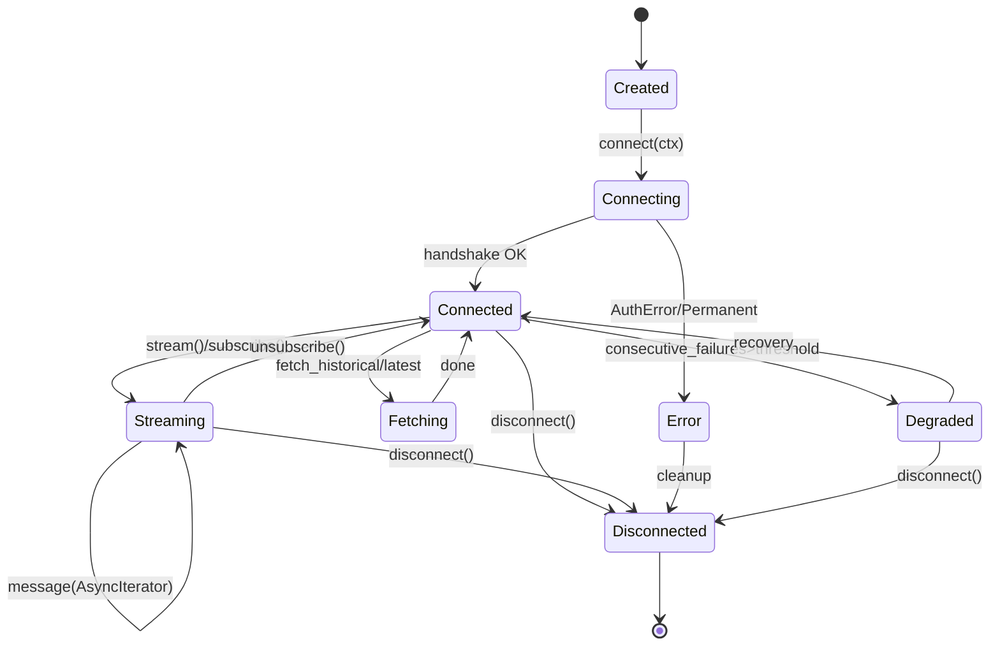

# Phase 2 — Task 1: Connector Framework — Design Report (Revised — pending approval)

> Design-only / documentation. No application code, packages, directories, dependencies, DB schema/migrations, project settings, or Git operations were changed. This document revises the earlier Connector Framework design and adds a Decision Log and Open Questions. **Status: proposals only — nothing in this document is an approved architectural decision unless explicitly marked "Approved" in the Decision Log (Section 16).**

## 1) Executive Summary

Task 1 of Phase 2 (per `PHASE_02_DATA_INFRA.md` and `MODULE_DATA_CONNECTOR.md`) establishes the **standard connector framework**: a single contract for connect/disconnect, health, historical/latest fetch, streaming, and status — plus a Connector Registry/Manager, secure credential handling, persistent data models, and a **Mock Connector** with **contract tests**. Per `ARCHITECTURE.md` (Modular Monolith + Independent Data Workers), connectors are a **data-infrastructure layer** usable by both the API (health/status, on-demand fetch) and future Celery data workers, without violating module boundaries (rules 4 & 5).

This revision applies five mandatory corrections: (A) explicit streaming contract with `stream() -> AsyncIterator` and REST-only providers not forced to stream; (B) separation of `credential_version` from `encryption_key_version` with multiple encrypted credential sets per source; (C) layered retry ownership (Connector vs Worker) with no nested uncontrolled retries; (D) strict logging-security with no raw provider data/secrets; (E) clarification of whether Task 1 requires a real provider connection (recorded as an open ambiguity with a resolution proposal).

## 2) Recommended Directory Structure (no dirs created)

Authoritative structure (`MASTER_PLAN.md`, `AI_PROJECT_CONTEXT.md`, `MODULE_DATA_CONNECTOR.md`) places `connectors/`, `services/`, `packages/` at repository root, with files under `connectors/{exchanges,blockchains,market-data,analytics-providers}/<name>/`.

Recommended: top-level `connectors/` package (shared by API and future workers):

```
connectors/
  pyproject.toml            # packaging (REQUIRES APPROVAL)
  __init__.py
  base.py                   # BaseConnector (ABC) + capability Protocols
  types.py                  # shared dataclasses / pydantic models
  errors.py                 # error hierarchy
  registry.py               # ConnectorRegistry / ConnectorManager
  credentials.py            # CredentialVault (Fernet) + KMS-ready interface
  config.py                 # per-connector config
  http.py                   # shared HTTP client (httpx) + provider rate-limit
  ws.py                     # shared WebSocket lifecycle
  mock/                     # MockConnector + configurable behaviors
  exchanges/{hyperliquid,binance,bybit,okx}/
  blockchains/  market-data/  analytics-providers/
apps/api/                   # consumer only: health/status/on-demand fetch
services/ (future)          # Celery workers — consumers of connectors
```

Compatibility note: current repo uses flat imports, `apps/api` as rootdir, `alembic.ini` `prepend_sys_path = .`, `pytest.ini` `testpaths = tests`. A top-level package requires either `pyproject.toml` + editable install (recommended) or adding repo root to `sys.path`/`pythonpath`. This is a packaging decision requiring approval.

## 3) Connector Interface Specification

Recommended: **ABC** (`BaseConnector`) for lifecycle + **capability Protocols** (`typing.Protocol`, `runtime_checkable`) so REST-only providers are not forced to implement streaming.

### 3.1 Core (ABC, required) — REVISED (secure credential injection)

```python
class BaseConnector(ABC):
    capabilities: Capabilities          # dataclass: rest, historical, latest, stream, subscribe
    auth_mode: AuthMode                 # enum: VAULT_SIGNING (preferred) | LEASE (raw in-memory)

    def __init__(self, credentials: CredentialProvider) -> None:
        self._credentials = credentials  # injected by ConnectorManager; NOT a secret itself

    @abstractmethod
    async def connect(self, ctx: ConnectContext) -> None: ...   # ctx is secret-free / serializable
    @abstractmethod
    async def disconnect(self) -> None: ...
    @abstractmethod
    async def health_check(self) -> HealthStatus: ...
    @abstractmethod
    async def get_status(self) -> ConnectorStatus: ...
```

`ConnectContext` carries only serializable, non-secret config (source_id, base_url, environment, timeouts). Secrets are **never** passed to `connect()` or stored on `ConnectContext`; the connector obtains credentials **out-of-band** through the injected `CredentialProvider` (Section 3.5).

### 3.2 REST capabilities (Protocol)
```python
@runtime_checkable
class HistoricalFetcher(Protocol):
    def fetch_historical(self, req: HistoricalRequest) -> AsyncIterator[RawRecord]: ...

@runtime_checkable
class LatestFetcher(Protocol):
    def fetch_latest(self, req: LatestRequest) -> AsyncIterator[RawRecord]: ...
```

### 3.3 Streaming capability (Protocol) — REVISED (Correction A)
```python
@runtime_checkable
class StreamProvider(Protocol):
    def stream(self, req: StreamRequest) -> AsyncIterator[StreamMessage]: ...
    async def subscribe(self, channels: Sequence[Subscription]) -> None: ...
    async def unsubscribe(self, channels: Sequence[Subscription]) -> None: ...
```

Streaming contract (REVISED):
- `stream()` returns an `AsyncIterator[StreamMessage]`, consumed by the caller with `async for`. The connector **does not** push to callbacks/queues; delivery mechanism is the async iterator. This defines exactly how the consumer receives data.
- `StreamMessage` = `RawRecord` + `stream_meta` (channel, seq, ts_event UTC, completeness, heartbeat flag).
- Backpressure: consumer-driven via async iterator; connector applies bounded buffering and yields control.
- Lifecycle: `connect()` → `subscribe()`/`stream()` → (heartbeats) → `unsubscribe()` → `disconnect()`; auto-reconnect with backoff inside `stream()`.
- **REST-only providers** declare `capabilities.stream = False` and **do not implement** `StreamProvider`. The Registry/Worker checks capability flags before use. REST vs WebSocket difference is explicit: REST = request/response pull (`fetch_*`), WebSocket = server push via `stream()`/`subscribe`.

### 3.4 Types, errors, pagination, time, completeness
- I/O via dataclasses/pydantic (validated). `RawRecord` = `source, symbol, type, ts_event(UTC), payload(raw dict), idempotency_key, completeness, trace_id`.
- Error hierarchy: `ConnectorError` → `TransientConnectorError` (network/5xx/429), `PermanentConnectorError` (4xx except 429 / invalid schema), `RateLimitError(retry_after)`, `AuthError`, `IncompleteDataError`.
- Pagination: cursor/offset, transparent to consumer (async iterator).
- Time ranges: `datetime[UTC]`, `start <= end`.
- Completeness: enum complete/partial/unknown + expected/received (feeds Task 4 quality).

### 3.5 Secure credential injection contract (NEW — resolves the `connect()` / `ConnectContext` contradiction)

**Problem:** `connect(ctx)` must not carry secrets, yet the connector still needs credentials. **Resolution:** the connector receives a `CredentialProvider` by **constructor injection** (composition); credentials are obtained **out-of-band** from the `CredentialVault` through that provider — never through `ConnectContext`, Celery messages, or any serializable structure.

```python
@runtime_checkable
class CredentialProvider(Protocol):
    # Preferred: Vault performs the secret-using operation; raw secret never enters the connector.
    async def auth_headers(self, method: str, path: str, body: bytes) -> dict[str, str]: ...
    async def sign(self, payload: bytes) -> bytes: ...
    # Fallback (auth_mode = LEASE): short-lived, in-memory access for providers that must use the secret directly.
    def lease(self) -> "CredentialLease": ...

class CredentialLease:                     # async context manager; in-memory only
    async def __aenter__(self) -> "CredentialBundle": ...
    async def __aexit__(self, *exc) -> None: ...   # best-effort zeroize + drop reference

class CredentialBundle:                    # NOT serializable; __repr__/__str__ redacted
    # holds api_key / api_secret / passphrase in memory for the lease scope only
    ...

@dataclass(frozen=True)
class ConnectContext:                      # SERIALIZABLE — no secret fields
    source_id: UUID
    base_url: str
    environment: str
    timeouts: Timeouts
    # ... other non-secret config
```

**Auth modes (connector declares `auth_mode`):**
- `VAULT_SIGNING` (preferred, default where feasible): the connector calls `await provider.auth_headers(...)` or `await provider.sign(...)`. The Vault decrypts internally and returns **Sensitive Derived Authentication Material (SDAM)** — e.g., Authorization/API-Key headers or a request signature (see Section 3.6). This is **not** "non-secret": it is sensitive and short-lived. Removing the raw secret from the connector does **not** make the derived output safe to log, persist, or reuse.
- `LEASE` (fallback): the connector uses `async with provider.lease() as cred:` to obtain a decrypted `CredentialBundle` for the **minimal scope** (e.g., building one request), uses it immediately, and exits the scope. Used only for providers whose SDK requires direct secret access.

**Example — preferred (vault_signing):**
```python
class SomeConnector(BaseConnector):
    auth_mode = AuthMode.VAULT_SIGNING
    async def _get(self, path: str):
        headers = await self._credentials.auth_headers("GET", path, b"")
        # SDAM: sensitive + short-lived — used for THIS request only, then dropped
        return await self._http.get(self._base_url + path, headers=headers)
```

**Example — fallback (lease):**
```python
async def _signed_request(self, method, path, body):
    async with self._credentials.lease() as cred:      # scope-limited, in-memory
        signature = hmac(cred.api_secret, body)        # used immediately
    # `signature` is SDAM (sensitive, replayable until expiry) — sent once, then dropped
    return await self._http.request(method, path, content=body, headers={"X-Signature": signature})
```

**Why this fits Modular Monolith:** the provider is an injected interface; the connector depends on the abstraction, not on the Vault or DB. The Vault is the only holder of the master key; the connector only ever holds a provider reference (no secret). This respects module boundaries (ARCHITECTURE rules 4, 5, 8) and is testable (a fake provider is injected in unit tests).

### 3.6 Derived Authentication Material — reclassification and handling (NEW)

**Reclassification.** The outputs of `auth_headers()` and `sign()` — and any Bearer token, API-Key header, or request signature produced from credentials — are classified as **Sensitive Derived Authentication Material (SDAM)**: sensitive, temporary, and potentially **replayable/reusable until expiry or consumption**. They are **not** "non-secret", and removing the raw secret from the connector does **not** make these outputs safe.

**Scope and lifetime.**
- SDAM is used **only for the single request it was produced for**.
- It is bound, as far as the provider allows, to that request's **method, path, and body** (and, where supported, a nonce/timestamp/expiry).
- Unnecessary retention and reuse are prohibited; SDAM is dropped from the operational scope **immediately after the request is sent**.

**Permitted transmission.** SDAM may be transmitted **only** to the **authorized provider endpoint**, over secure transport (**HTTPS/WSS** as applicable), and **only as part of the exact request for which it was generated** (consistent with the examples in Section 3.5, where SDAM is handed to the HTTP client for the intended provider request).

**Prohibited destinations and channels.** SDAM must never be sent to or exposed through:
- application logs or audit logs;
- exception messages or stack traces;
- database storage;
- Celery messages;
- API responses or the frontend;
- telemetry, analytics, or third-party debugging services;
- serialization or debug output;
- **any destination other than the authorized provider endpoint for the intended request.**

**Representation hygiene.** SDAM values (header dicts, signature strings, tokens) must **never** appear in `repr()`/`str()` of any object, in HTTP client debug logs, or in debugger output. Wrapper types for SDAM must redact `__repr__`/`__str__`; connectors must not pass SDAM to any logging or debug facility.

**Honest security limitations.**
- Removing the raw secret from the connector does **not** make the derived authentication output non-sensitive.
- A generated signature/token may remain **sensitive and replayable until it expires or is consumed**; it must be handled with the same care as the secret for its (short) lifetime.
- Memory erasure in Python is **not guaranteed** (immutable `str`, GC copies); zeroization is best-effort only.
- Replay resistance depends on the provider's scheme (nonce/timestamp/expiry); where a provider does not support it, this is an accepted residual risk to be documented per connector.

## 4) Connector Lifecycle Diagram



## 5) Credential Security Architecture — REVISED (Correction B)

Authoritative basis: `SECURITY_POLICY.md` (encrypted storage; no secrets in frontend or logs; access restriction; revoke/disable; encrypted at rest), `MODULE_DATA_CONNECTOR.md` (encrypted keys; no keys in logs/frontend). **Plaintext secrets must never be stored in PostgreSQL.**

### 5.1 Separation of versions (REVISED)
- `credential_version` — a **logical, monotonically increasing identifier of a credential SET** for a data source (e.g., `v1`, `v2`). Multiple sets can coexist (rotation overlap, separate read-only vs fallback keys, per-environment).
- `encryption_key_version` — identifies **which encryption key (Fernet key id / future KMS key id)** was used to encrypt that set's payload. Enables **key rotation without changing credentials** and vice-versa.
- These are orthogonal: rotating the encryption key increments `encryption_key_version`; rotating provider credentials increments `credential_version`.

### 5.2 Multiple credential sets per data source (REVISED)
- One data source may have **N credential sets** (`api_credentials` rows), each stored as **one encrypted payload** (the whole set — e.g., `{api_key, api_secret, passphrase}` — encrypted as a single blob).
- Each set has: `credential_version`, `encryption_key_version`, `status` (active/rotated/revoked), `created_at`, `rotated_at`, `expires_at`, `last4_hint` (masked, for UI only), `algorithm`.
- Only one set is `active` per source at a time; others are `rotated`/`revoked` and retained for overlap/rollback.

### 5.3 Access, logging, and API boundaries (REVISED — Correction 4)

**CredentialVault security boundary (explicit):**
- **Decryption only via `CredentialVault`.** It is the sole component that decrypts; no other module holds the master key or decrypts ciphertext.
- **Raw secret lifetime:** the decrypted secret exists **only in memory** and only for as long as the connector needs it (e.g., during `connect()` or request signing); it is discarded as soon as possible and never written to persistent storage.
- **Never stored plaintext in the database:** `api_credentials` stores only ciphertext.
- **Never placed in:** logs, exception messages, `ConnectContext` (which must remain serializable and secret-free — secrets are handed to the connector out-of-band, never embedded in serializable context), or Celery messages.
- **Never exposed** in the frontend or public API output.
- **No public read path:** there is no public endpoint or API to read a decrypted secret. The credential API is **write-only** and returns **masked** data only (`id`, `credential_version`, `encryption_key_version`, `last4_hint`, `status`, timestamps) — never ciphertext or secrets.
- **Redaction filter** applied to all logs/exceptions; secrets never logged (aligns with `logger.py` `SENSITIVE_HEADERS`).
- **Security tests** must verify the absence of secret leakage across DB, logs, API responses, serialized `ConnectContext`, and message payloads (see Section 10).

### 5.3.1 Credential flow (Vault → Connector) and responsibility split

1. **ConnectorManager** loads the `DataSource` and resolves the **active `credential_version`** for the source (identifiers only — no secret).
2. Manager calls `CredentialVault.provider_for(source_id, credential_version=active)`, returning a **`CredentialProvider`** bound to that source. The provider holds only `source_id` + key reference — **never plaintext**.
3. Manager constructs `Connector(credentials=provider)` and calls `await connector.connect(ctx)` with a **secret-free, serializable** `ConnectContext`.
4. When auth is needed the connector uses the provider: **`VAULT_SIGNING`** → `await provider.auth_headers(...)`/`await provider.sign(...)` producing **SDAM** (Vault decrypts internally; raw secret stays inside the Vault; the SDAM output is used for that one request and then dropped — Section 3.6); or **`LEASE`** → `async with provider.lease() as cred:` for a scope-limited in-memory bundle, then dropped.
5. On `disconnect()` or task completion, connector and provider references are released; any lease is exited (best-effort zeroize).

**Responsibility split:**
- **CredentialVault:** sole master-key holder; decrypts; exposes `provider_for(...)`; returns **SDAM** or short-lived leases; never logs secrets or SDAM.
- **CredentialProvider (Vault-side adapter):** binds a source to its active credential; performs signing/header derivation or leases; persists nothing; SDAM is returned for one request only.
- **ConnectorManager:** resolves identifiers, builds and injects the provider, manages lifecycle; never sees plaintext.
- **Connector:** consumes the provider via `auth_mode`; never receives secrets via `ConnectContext`; never persists/logs secrets.

### 5.3.2 Guarantees and honest limitations

**Guarantees (enforced by design + tests):**
- `ConnectContext` is a frozen, serializable dataclass with **no secret-typed fields**; a unit test asserts `json.dumps(asdict(ctx))` succeeds, contains no secret keys, and no field is annotated as a secret type.
- Secrets are **never** placed in: DB (ciphertext only), logs, exception messages, `ConnectContext`, Celery task args/messages, API responses, or the frontend. Celery messages carry only scalar identifiers (e.g., `source_id`); the provider is **reconstructed in-worker** from the Vault, never serialized.
- `CredentialBundle.__repr__`/`__str__` are redacted; the logging redaction filter + credential-security tests assert no secret patterns anywhere (Section 10).
- **SDAM (Section 3.6) is handled as sensitive and short-lived:** never logged (incl. audit logs), never placed in exceptions/stack traces, DB, Celery messages, API responses, frontend, serialization, or debug output; redacted in `__repr__`/`__str__`; used for one request only and dropped immediately after send.

**Memory-erasure limitation (honest disclosure):** Python does **not** guarantee secure memory erasure. `str` is immutable and the interpreter/GC may leave transient copies; zeroizing a `bytearray` is **best-effort only**. Therefore this design (a) minimizes secret lifetime (lease scope / vault-side signing), (b) prefers `VAULT_SIGNING` so plaintext never enters the connector at all, and (c) performs best-effort zeroization on lease exit. **We do not claim guaranteed wiping of plaintext from process memory.** SDAM (signatures/tokens) may remain sensitive and replayable until expiry/consumption and is handled as sensitive for that window; this design does not guarantee its erasure from memory either. Preventing swap/core-dumps is an OS/deployment concern, out of scope here.

### 5.4 Key rotation & KMS migration path (REVISED)
- Dev: master key from env (`CONNECTOR_ENCRYPTION_KEY`). Prod (future): Secret Manager (AWS/GCP/Azure) or Vault.
- Rotation: add new key as new `encryption_key_version`; re-encrypt active sets to new version; decrypt old with old version during transition; then retire old key.
- KMS path: `CredentialVault` is defined against an interface (`KeyProvider`) with a `LocalFernetKeyProvider` now and a `KmsKeyProvider` later — no call-site changes when migrating to KMS/envelope encryption.
- All key creation/encryption operations are out of scope for this design task (design only).

## 6) Database Schema Proposal

Integrates with existing `Base` and `AuditLog` (`models.py`, `DeclarativeBase`); timestamps UTC; UUID PKs.

### 6.1 `data_sources`
- `id` UUID PK · `name` str(255) UNIQUE · `source_type` enum(cex,dex,blockchain,analytics) · `provider` str(100) · `environment` str(50) default "production" · `config` JSONB (no secrets) · `enabled` bool · `priority` int · `created_at`/`updated_at` TZ.
- Indexes: unique `name`; `(source_type, enabled)`.
- Relations: 1:N → status/logs/credentials.

### 6.2 `data_source_status` (current state)
- `id` UUID PK · `data_source_id` UUID FK→data_sources · `state` enum(connected,degraded,error,disconnected) · `last_heartbeat` TZ · `last_success_at` TZ · `last_error_code` str · `latency_ms` int · `consecutive_failures` int default 0 · `updated_at` TZ.
- Unique `(data_source_id)` (one current row/source). History via `connector_logs`.

### 6.3 `connector_logs`
- `id` bigserial PK · `data_source_id` UUID FK · `level` enum · `event` str(100) · `error_code` str(100) nullable · `exception_type` str(255) nullable · `message` str(1024) nullable (**FILTERED/SAFE — REVISED, Correction D**) · `request_id` UUID nullable · `http_status` int nullable · `latency_ms` int nullable · `created_at` TZ indexed.
- Indexes: `(data_source_id, created_at)`, `(level, created_at)`.
- Retention: time-based purge (30–90 days); time partitioning later (Timescale/partitioning — later decision).

### 6.4 `api_credentials` — REVISED (Correction B)
- `id` UUID PK · `data_source_id` UUID FK · `credential_version` str(50) · `encryption_key_version` str(50) · `ciphertext` text/bytea NOT NULL (encrypted payload of the whole set) · `algorithm` str(50) default "fernet" · `last4_hint` str(4) nullable · `status` enum(active,rotated,revoked) · `created_at`/`rotated_at`/`expires_at` TZ.
- Constraints/Indexes: UNIQUE `(data_source_id, credential_version)`; partial unique one `active` per source (enforced in app/DB); index `status`.
- Relations: N:1 → data_sources. Sensitive create/rotate/revoke → `audit()` into `audit_logs` (no secrets).

## 7) Component Responsibility Boundaries

| Component | Responsibility | Integration point (future) |
|---|---|---|
| Connector | Provider I/O only (connect/fetch/stream/health); consumes an injected `CredentialProvider` via `auth_mode`; never holds secrets beyond a lease scope | — |
| ConnectorRegistry/Manager | Lifecycle, scheduling, resolves active credential, builds + injects `CredentialProvider`, health, capability checks; never sees plaintext | called by Celery/API |
| CredentialVault | Sole master-key holder; decrypts; exposes `provider_for(...)` (signing/lease); redaction; no secret logging | only ConnectorManager |
| FastAPI | health/status, on-demand fetch; no synchronous ingestion loop | `/health`,`/ready`, future `/sources` |
| Celery (Workers) | Ingestion, task-level retry, DLQ, provider rate-limit | Task 5/6/7 |
| Redis | Celery broker + provider rate-limit counters + cache | Task 7 |
| PostgreSQL | raw/normalized/status/logs/credentials | — |
| Normalizer | raw → standard schema | Task 3 |
| Data Quality | wash/sybil/cross-source/staleness | Task 4 |
| Event Processor | dedup/idempotency/recovery | Task 5 |
| Raw Data Storage | `raw_events` | Task 6 |
| Realtime Gateway (WS) | realtime publish | Phase 7 |

Provider-specific logic never enters the analysis core (ARCHITECTURE rule 8). Flow: Connector → Raw Storage → Normalizer → Quality → Event Processor → Engines.

## 8) Retry / Timeout / Rate-limit / Error Policies — REVISED (Correction C)

### 8.1 Layered retry ownership (REVISED — Corrections 1 & 3)

Retry is owned at two distinct layers and must never nest into an uncontrolled storm:

- **Connector (per-request HTTP retry) — designed and tested in Task 1:**
  - Applies only to **idempotent** requests and transient failures (`TransientConnectorError`, network errors, 5xx, and 429).
  - **HTTP 429:** the connector reads `Retry-After` when present (delta-seconds or HTTP-date) and waits at least that long before the next attempt. When `Retry-After` is absent, it falls back to exponential backoff + jitter.
  - **Bounded budget:** retry stops after a configurable `max_attempts` and a configurable `max_total_wait` (wall-clock budget). Proposed defaults (NOT final — require approval): `max_attempts = 3`, `max_total_wait = 30s`, base backoff 0.5s, cap 8s, jitter ±20%.
  - **Budget exhausted:** if the retry budget is spent (attempts or max wait), or `Retry-After` exceeds `max_total_wait`, the connector stops retrying and raises `RateLimitError(retry_after=...)` to the caller. It never sleeps beyond the budget.
  - **No retry** on `AuthError` or `PermanentConnectorError`.
  - Suggested configurable keys (per connector, pending approval): `connector.retry.max_attempts`, `connector.retry.max_total_wait_seconds`, `connector.retry.base_backoff_seconds`, `connector.retry.backoff_cap_seconds`, `connector.retry.jitter_ratio`.

- **Worker/Celery (task-level retry) — implemented and tested in Task 7 (NOT Task 1):**
  - Owns run-level retry and recovery of failed ingestion tasks (Celery retry/backoff + Dead Letter Queue).
  - Re-runs a failed task; it does not perform per-HTTP-call retries.
  - **No early Celery in Task 1:** Task 1 only designs/tests the connector-level retry and error contract; Celery task retry, recovery and DLQ are implemented in Task 7. (Note: official `PHASE_02_DATA_INFRA.md` also lists recovery/DLQ under Task 5 — see the conflict in Q7.)

- **No nested uncontrolled retries:** the connector's inner request-retry and the worker's outer task-retry are bounded independently. A connector that has exhausted its request-retry budget surfaces `RateLimitError`/failure to the worker, which applies a single task-level retry — never another inner loop.

- **Timeout:** separate `connect_timeout`, `read_timeout`, `ws_timeout`, per connector (configurable, pending approval).

### 8.2 Provider rate-limit vs user API rate-limit (REVISED)
- Two independent limiters (per `MODULE_RATE_LIMITING.md`: internal API limits + external provider limit management):
  - **Provider rate-limit** (external): per-source counters in Redis (`ratelimit:provider:<source>:<window>`), budget-aware, governs outbound calls. Lives with connectors/workers.
  - **User API rate-limit** (internal): existing `rate_limit.py` per-user/IP/endpoint middleware. Governs inbound API clients.
- They are separate concerns and must not share counters or configuration.

### 8.3 Error mapping
Map HTTP/WS statuses to the error hierarchy; log structured fields only (Section 9); never log raw provider payloads.

## 9) Logging Security — REVISED (Correction D)

Authoritative: `SECURITY_POLICY.md` (no secrets in logs). Rules (REVISED, explicit):
- **Prohibited in logs:** HTTP headers, raw provider response bodies, credentials, and any sensitive info. Do not store them anywhere (DB/log/API/frontend).
- **`connector_logs.message` must not contain raw unfiltered provider error text.** Store a **safe, structured** message or a normalized `error_code` instead. Raw provider error is discarded or reduced to a mapped `error_code`.
- **Allowed structured fields:** `error_code`, `exception_type`, `request_id`, `http_status`, `latency_ms`, `event`, `level`, `data_source_id`.
- **Secret-leakage prevention policy (explicit):**
  1. Redaction filter on all log records and exception formatting (keys: authorization, api-key, x-api-key, cookie, set-cookie, proxy-authorization, tokens, secrets).
  2. CredentialVault never returns secrets to loggers; connectors never log request/response bodies.
  3. `connector_logs.message` is generated from a fixed allowlist of safe templates; raw `str(exc)` from provider clients is never written verbatim.
  4. Tests assert no secret patterns in DB/log/API output (credential-security tests).

## 10) Mock Connector & Test Strategy

Basis: `TESTING_STRATEGY.md` (Contract tests; Mock connectors for tests; no real API in unit tests).

**Task 1 vs Task 2 boundary (Correction 2 — aligned with `PHASE_02_DATA_INFRA.md` Task 1 = "Connector framework (standard contract)" and Task 2 = "Mock connectors for tests"):**
- **Task 1 (this task):** implement the **minimum MockConnector** required to validate the interface and run the contract test suite — basic `connect`/`disconnect`/`health_check`/`get_status`, a trivial `fetch_latest`, a trivial `stream`, and correct capability flags. Goal: prove the contract is implementable and testable.
- **Task 2:** expand MockConnector with simulated behaviors — latency, varied errors (timeout/429/401/500), pagination, partial/incomplete data, WebSocket disconnect/reconnect, and duplicate events (idempotency).
- This split matches the official plan; **no change to the official phase plan is proposed.**

Remaining test strategy (applies across tasks):
- **Contract test suite (parameterized):** one suite run against MockConnector and every real connector, asserting connect/disconnect/health/get_status/capabilities/fetch/stream conformance.
- **Unit tests:** per connector with mocked HTTP/WS (e.g., `respx`/`pytest-httpx`, mocked `websockets`); no real API calls.
- **Integration tests:** real source in staging behind an env flag (not default CI).
- **Failure simulation:** timeout, 429/401, disconnect, partial data, retry exhaustion → task failure (expanded in Task 2).
- **Retry tests:** verify bounded connector retries, no retry on auth/permanent, `Retry-After` honored, budget exhaustion raises `RateLimitError`, and no nested retry storm between connector and worker.
- **Credential-security tests:** no plaintext in DB/log/API/serialized context/messages; API write-only + masked; decryption only via Vault; **SDAM (`auth_headers()`/`sign()` outputs) never appears in logs, audit logs, exceptions/stack traces, DB, Celery messages, API responses, frontend, serialization, debug output, or `repr()`/`str()`**, and is scoped to a single request.
- **Idempotency expectations:** duplicate `idempotency_key` → single normalized event (finalized in Task 5; Task 1 guarantees the key exists on `RawRecord`).

## 11) First Provider Recommendation & Phase 2 Exit Timing (Correction 5)

**Constraint (authoritative):** `PHASE_02_DATA_INFRA.md` line 11 lists the Phase 2 **exit** as ">=1 source connected; data normalized; dupes detected; quality reported; recovery works." Because "≥1 source connected" is a **Phase 2 exit criterion**, it must be satisfied **within Phase 2** and cannot be silently deferred to Phase 3 without an explicit, approved plan change.

**Recommendation (pending approval):**
- **Hyperliquid** is the first real provider (official priority #1; public data without keys; REST + WebSocket; generous limits; high product relevance).
- It should be scheduled **inside Phase 2**, with its **integration test in staging** (real source), not a unit test (`TESTING_STRATEGY.md` line 22 forbids real APIs in unit tests).
- **Task 1 remains framework + contract + MockConnector only**; real provider integration is a **separate task**.
- **Proposed new task (proposal only — the official `PHASE_02_DATA_INFRA.md` is NOT edited here):** add a Phase 2 task, tentatively "First Real Connector (Hyperliquid) + staging integration," to be numbered/placed by the user in the official phase plan if approved.
- Until the user decides, this remains **Open Question Q1** (reframed: which Phase 2 task delivers the first real provider, given it cannot be deferred out of Phase 2).

## 12) Dependencies to Install Later (not installed now)

| Dependency | Justification | Stage |
|---|---|---|
| `httpx` | async HTTP client for REST connectors | Task 1 (after approval) |
| `websockets` | WS client for streaming | Task 1/providers |
| `cryptography` (Fernet) | credential encryption at rest | Task 1 |
| `tenacity` (or custom) | bounded backoff/jitter | Task 1/6 |
| `respx`/`pytest-httpx` | HTTP mocking in tests | Task 1 |
| `celery` | queue/worker (already in requirements) | Task 7 |

## 13) Risks & Unresolved Decisions

- Connector placement/packaging (top-level package + `pyproject`) — needs approval.
- Master-key storage in production (Secret Manager vs Vault).
- `raw_events` schema and raw/processed split (DATABASE_DESIGN open; Tasks 3/5).
- TimescaleDB for time-series (later Phase 2 decision).
- REST vs WS per provider; budget constraints.
- Append-only status history table (Task 6?).
- Celery worker location and how workers import the connectors package.
- Alignment with current flat-import + `alembic prepend_sys_path=.` setup.

## 14) Task Dependencies (Task 1 ↔ later tasks)

- Task 1 provides: contract (ABC + Protocols), types/errors, Registry/Manager skeleton, CredentialVault, four models + migration, **minimal MockConnector** for interface validation, contract/unit/security tests, and **connector-level retry design + tests**. **No Celery.**
- Task 2 (Mock connectors for tests): consumes the contract; expands MockConnector with simulated behaviors (latency, varied errors, pagination, partial data, WS disconnect, duplicate events).
- Task 3 (Normalizer): consumes `RawRecord` (with `idempotency_key`, `completeness`).
- Task 4 (Quality): consumes completeness + normalized data (wash/sybil/staleness).
- Task 5 (Event Processor): consumes `idempotency_key` for dedup; per official `PHASE_02_DATA_INFRA.md`, owns **recovery and DLQ** at the event-processing level.
- Task 6 (Raw storage / provider health / retry): uses `connector_logs`, `data_source_status`, provider rate-limit.
- Task 7 (Celery/Redis queue): workers execute connectors; provider rate-limit counters in Redis. Per the user's proposed split this task would also own **Celery task-level retry, recovery, and DLQ** — but that **overlaps/conflicts** with Task 5's official recovery/DLQ scope (see Q7); not resolved here.

## 15) Acceptance Criteria Mapping (Phase 2)

| Task 1 (official) | How satisfied |
|---|---|
| Connector framework (standard contract) | ABC + capability Protocols + types/errors |
| Mock connectors for tests | **Task 1:** minimal MockConnector for interface validation + contract tests; **Task 2:** full simulated behaviors |
| Contract tests | parameterized suite (Mock + real) |
| DB: data_sources/status/connector_logs/api_credentials | models + migration (no plaintext) |
| Security: encrypted keys; no keys in logs/frontend | Fernet + Vault + redaction + write-only |
| Acceptance (module): health reported; retry works | health/status + connector-level bounded retry (Celery retry is Task 7) |

Phase 2 exit (`>=1 source connected; normalized; dupes; quality; recovery`) spans later Phase 2 tasks and is **NOT** met by Task 1. "≥1 source connected" must be satisfied **within Phase 2** (Correction 5) — see Section 11 and Open Question Q1.

## 16) Decision Log

The five corrections in this revision (Sections 5.3, 8.1, 10, 11, 18) are **agreed design direction**. That agreement does **NOT** auto-approve the architecture decisions below. **No decision is marked "Approved" unless the user explicitly says so.** Status values: `Proposed` (idea recorded, not yet reviewed), `Pending Approval` (concrete proposal awaiting user sign-off), `Approved` (explicit user approval on record — none currently).

| ID | Decision (description) | Current proposal | Technical consequences | Status |
|---|---|---|---|---|
| D1 | Connector placement | Top-level `connectors/` package | Shared by API + future workers; needs import/packaging setup | Pending Approval |
| D2 | Packaging/import | `pyproject.toml` + editable install (alt: `sys.path`/`pythonpath`) | Affects alembic `prepend_sys_path`, pytest rootdir, CI | Pending Approval |
| D3 | Contract pattern | ABC (lifecycle) + capability Protocols | REST-only providers exempt from streaming | Proposed |
| D4 | Streaming contract | `stream() -> AsyncIterator[StreamMessage]`; REST-only exempt | Defines consumer receive model + backpressure | Proposed |
| D5 | Credential versioning | `credential_version` ≠ `encryption_key_version`; N sets/source; one encrypted payload | Schema + rotation semantics | Proposed |
| D6 | Credential access | Decrypt only via `CredentialVault`; write-only + masked API; no raw secret anywhere | Security boundary + tests | Proposed |
| D7 | Key rotation / KMS | Versioned keys now; `KeyProvider` interface → KMS later | Future KMS migration without call-site change | Proposed |
| D8 | Retry ownership | Connector bounded request-retry (idempotent, honors `Retry-After`, no auth retry); Worker task-retry; no nested storms | Retry config keys; Task 1 vs Task 7 split | Proposed |
| D8a | Retry config values | `max_attempts=3`, `max_total_wait=30s`, base 0.5s, cap 8s, jitter ±20% | Tunable per connector; not final | Proposed |
| D9 | Rate-limit split | Provider (outbound) vs user API (inbound) independent limiters | Separate Redis counters/config | Proposed |
| D10 | Logging security | No headers/raw body/secrets; safe structured fields; filtered `message` | Log schema + redaction filter | Proposed |
| D11 | First provider | Hyperliquid, within Phase 2, staging integration (separate task) | Adds a Phase 2 task (proposal only) | Pending Approval |
| D12 | Ingestion runtime | Celery workers; API read-only health/on-demand | Worker placement + import path | Pending Approval |
| D13 | Future deps | httpx, websockets, cryptography, (tenacity), respx | requirements changes (later) | Pending Approval |
| D14 | DB schema | Four tables per Section 6 | New models + migration (later) | Pending Approval |
| D15 | Credential injection contract | Constructor-injected `CredentialProvider`; secrets out-of-band via Vault (preferred `VAULT_SIGNING`, fallback `LEASE`); `ConnectContext` secret-free | Resolves the `connect()`/security contradiction; per-connector `auth_mode`; memory-erasure limitation documented | Pending Approval |

## 17) Open Questions

- **Q1 (First real provider timing — reframed, see Section 18):** Given "≥1 source connected" is a **Phase 2 exit criterion** and cannot be deferred to Phase 3 without an approved plan change, **which Phase 2 task** delivers the first real provider (Hyperliquid) + staging integration, and when? Task 1 stays framework-only.
- Q2: Approve top-level `connectors/` + `pyproject.toml` packaging approach (D1/D2)?
- Q3: Production master-key storage (Secret Manager vs Vault) — decide before production; dev uses env.
- Q4: `raw_events` schema / raw-vs-processed split (Tasks 3/5) and TimescaleDB decision.
- Q5: Append-only status-history table vs logs-only history.
- Q6: Celery worker location and import path to the connectors package (D12).
- **Q7 (conflict — recovery/DLQ ownership):** Official `PHASE_02_DATA_INFRA.md` assigns **recovery and DLQ** to **Task 5 (Event Processor)** and only "Message queue (Celery on Redis)" to **Task 7**. The requested split assigns **Celery task-level retry, recovery, and DLQ** to **Task 7**. This is a real overlap/conflict. Options to decide: (a) Task 7 owns Celery **transport-level** retry + DLQ, Task 5 owns **event-level** dedup/idempotency/recovery semantics; (b) consolidate recovery/DLQ under one task. Recorded as open; no silent choice made.
- Q8: Approve proposed connector-retry config keys/defaults (D8a): `max_attempts`, `max_total_wait`, backoff base/cap, jitter.
- **Q9 (proposed new task):** Approve adding a Phase 2 task "First Real Connector (Hyperliquid) + staging integration" (proposal only; official phase plan not edited).

## 18) Task 1 Real-Provider Connection — Ambiguity Analysis (Correction E)

Authoritative references:
- `PHASE_02_DATA_INFRA.md` line 4–11: Task 1 = "Connector framework (standard contract)"; Task 2 = "Mock connectors for tests"; **Exit** (line 11) = ">=1 source connected; data normalized; dupes detected; quality reported; recovery works." → The "≥1 source connected" is stated as a **Phase-level exit criterion**, not as Task 1's own deliverable.
- `MODULE_DATA_CONNECTOR.md` line 15: "Acceptance: >=1 source connected; health reported; retry works; mock connector for tests." and line 17 "Phase: 2,3,5". → The module's acceptance lists "≥1 source connected", but the module spans Phases 2, 3, and 5.
- `TESTING_STRATEGY.md` line 22: "Mock connectors for tests (no real API in unit tests)." → unit tests must not hit a real API.

**Conflict (precise):**
- `PHASE_02_DATA_INFRA.md` frames Task 1 as the framework and places "≥1 source connected" at the **phase exit**, implying no real provider is required inside Task 1.
- `MODULE_DATA_CONNECTOR.md` lists "≥1 source connected" under the module's **acceptance**, which could be read as required for the connector module (and thus potentially Task 1).

**Proposed resolution (recommended, pending approval):**
- Task 1 delivers the **framework + minimal MockConnector + contract/unit/security tests only** (no real provider), consistent with `PHASE_02_DATA_INFRA.md` Task 1 and `TESTING_STRATEGY.md` (no real API in unit tests).
- Because "≥1 source connected" is a **Phase 2 exit criterion**, it is satisfied **within Phase 2** (NOT deferred to Phase 3) by adding the first real connector (**Hyperliquid**) in a **separate Phase 2 task** (proposed; see Q9), verified by a **staging integration test** (real source) rather than a unit test.
- Until the user decides, **Q1 remains OPEN** (which Phase 2 task + timing). No real provider connection is designed or implemented here.

### 18.1 Conflict — recovery/DLQ ownership (Task 5 vs Task 7)

- `PHASE_02_DATA_INFRA.md` line 8: **Task 5 = "Event Processor (dedup, idempotency, recovery, DLQ)"**; line 10: **Task 7 = "Message queue (Celery on Redis)"**. → Official plan places recovery/DLQ under **Task 5**.
- The requested revision assigns **Celery task-level retry, recovery, and DLQ** to **Task 7**.
- **This is a genuine conflict** between the official plan and the requested split. It is recorded here and as **Q7**; no unilateral choice is made. Proposed reconciliation (pending approval): Task 7 = Celery **transport-level** retry + DLQ mechanics; Task 5 = **event-level** dedup/idempotency/recovery semantics. Final ownership to be decided by the user.

## 19) Implementation Sequence for Task 1 (after approval)

1. Approve Open Questions Q1–Q9 (esp. placement/packaging D1/D2, credential approach, Hyperliquid + Phase 2 timing Q1/Q9, and the Task 5/Task 7 recovery/DLQ conflict Q7).
2. Packaging/import setup (no provider logic).
3. Contract: `base.py` (ABC) + capability Protocols + `types.py` + `errors.py` (incl. `stream()`).
4. Models (`DataSource`, `DataSourceStatus`, `ConnectorLog`, `ApiCredential`) + Alembic migration (no plaintext).
5. `CredentialVault` (Fernet) + `KeyProvider` interface + per-connector config (incl. retry config keys, pending approval).
6. `ConnectorRegistry`/`ConnectorManager` skeleton (capability checks, credential injection).
7. **Minimal** `MockConnector` (REST + streaming variants) — sufficient for interface validation + contract tests (Task 2 expands behaviors).
8. Connector-level retry logic + error contract; contract test suite + unit + credential-security + retry tests. **No Celery** (Task 7).
9. (Optional) read-only status/health surfacing — integration point only.

Out of scope: real provider integration, Normalizer (T3), Quality (T4), Event Processor (T5), queue (T7).